## TL;DR

- [Semantichelp](https://semantichelp.com/) is a multi-tenant SaaS knowledge base: an organization uploads its documents into a folder catalog, then asks questions and gets streaming answers that cite the passages they came from.
- The differentiator is what happens **when it can't answer**: the question escalates to the owner of that folder or document, and their reply is written back into the catalog as a citable Q&A document.
- Built solo for [Vertex Plus Group](https://vertexplusgroup.com/) on **Nuxt 4 + Cloudflare Workers** (D1, R2, Vectorize, Queues), end to end. v1 is in production with a first real tenant.

## Context

Every "chat with your docs" tool has the same two outcomes. Sometimes it answers. Sometimes it shrugs: *I couldn't find that in the documents.*

The shrug is where these products quietly die. The person with a real question has just been told the knowledge base is not for them — and the gap they hit is one a colleague could have closed in a sentence. The catalog learns nothing, and the same question is asked again next month by someone else.

That shrug is the product surface here. An unanswered question is not a dead end, it's a ticket: it goes to whoever owns that area, their answer becomes a document, and the knowledge base improves by being used.

The users are an organization's own staff — an **admin** who sets the workspace up and configures the AI provider, an **editor** who builds the catalog, and **viewers** who read and ask. The person asking is usually not the person who wrote the document, which is why an answer without its source is not an answer.

## Constraints

| Constraint | Reality |
|---|---|
| Team | One person — product decisions, UI, schema, prompts, deploy |
| Runtime | Cloudflare Workers only: no always-on server, no long-lived process |
| Storage | D1 (SQLite) + R2 + Vectorize; no Postgres, no pgvector |
| Communication | No mail infrastructure, so no verification email and no reset link |
| Sessions | A single 24-hour JWT, no refresh token |
| Isolation | One organization's documents, questions and conversations invisible to every other — a product promise, not a technicality |
| Cost | Per-tenant ceilings that have to hold without a billing system to enforce them |

The non-negotiable: a team signs up, uploads a document, and gets a cited answer the same day, with no infrastructure work on their side.

## Architecture at a glance

```mermaid
flowchart LR
  classDef ext fill:#e5e7eb,stroke:#6b7280,color:#282a30
  classDef svc fill:#dbeafe,stroke:#0f4c5c,color:#282a30
  classDef data fill:#d1fae5,stroke:#0f766e,color:#282a30
  classDef client fill:#fef3c7,stroke:#f59e0b,color:#282a30

  UP[Upload PDF / DOCX / TXT / MD] --> R2[(R2 object)]
  UP --> D1[(D1 documents row)]
  D1 --> Q[[Ingest queue]]
  Q --> EX[Extract text]
  EX --> CH[Chunk + label section]
  CH --> EM[Embed]
  EM --> VI[(Vectorize index)]
  ASK[Question in chat] --> RET[Retrieve top 5, tenant-filtered]
  VI --> RET
  RET --> LLM[Stream answer + citations]
  LLM -->|cannot answer| ESC[Escalate to owner]
  ESC --> ANS[Owner answers in the Questions inbox]
  ANS --> QA[Folder Q&A document regenerated]
  QA --> Q
  class UP,ASK,ESC,ANS client
  class EX,CH,EM,RET,LLM,QA svc
  class R2,D1,VI data
```

## Decisions

### Decision 1 — D1 + Vectorize instead of Postgres + pgvector

Postgres with pgvector is the obvious stack for a RAG product, and a good one. It is also a database server to run, patch and pay for — the one piece an edge-only product exists to avoid.

| Option | Trade-off | Chose |
|---|---|---|
| Postgres + pgvector on a managed VM | Mature, one system for rows and vectors; a server to run and a region to pick | |
| D1 (SQLite) + Vectorize on Workers | No server, no cold region, one deploy; SQLite's limits and a second index to keep honest | <DecisionCheck /> |

The price shows up three times. `status: ready` does not mean searchable, because Vectorize applies upserts asynchronously — a question asked within about a minute of an upload can return nothing while every row looks healthy. The index is 768-dimensional, so it decides which embedding models are usable: a 1024-wide model fails the whole batch, which is why the picker lists two models rather than "any". And because D1 bills rows read, every tenant-scoped table needed a composite index whose second column is the query's own predicate; the folder list went 6.6 ms → 0.63 ms.

### Decision 2 — Ingest through a queue, with an inline fallback

Extracting, chunking and embedding a 50 MB PDF does not fit in a request, or reliably in one Worker invocation. Ingestion is a job, so it is modelled as one.

| Option | Trade-off | Chose |
|---|---|---|
| Process the upload in the request (or behind `waitUntil`) | No queue to provision; a big document can exceed the execution ceiling and fail with no retry | |
| Send an ingest job to a Cloudflare Queue | Three retries 30 s apart, a dead-letter queue for what never succeeds, a cron sweeper for a job that goes silent; nothing is searchable the instant it is uploaded | <DecisionCheck /> |

The queue's cost is honesty about time: an upload is not an answerable source yet, and a freshly written-back Q&A document is not retrievable for roughly **30–60 seconds**, the same Vectorize lag now visible in a user-facing loop. The catalog shows per-document status (`processing` → `ready` / `failed`) because that window exists. Without a queue binding — local dev, or a deploy whose queue is not provisioned — the job runs inline behind `waitUntil` rather than being silently dropped.

### Decision 3 — Citations are part of the answer, not decoration

Every claim carries a numbered citation that opens the source document at the cited passage. That constrains the whole pipeline: the chunk the model reads and the chunk the citation shows must be the *same* passage, untruncated.

| Option | Trade-off | Chose |
|---|---|---|
| Answer first, link the document afterwards | Cheaper prompts, simpler UI; the reader cannot verify a claim without re-reading the source | |
| Store each chunk whole, label it with document and section, cite back to it | Larger prompts and a stricter chunker; every claim is one click from its evidence | <DecisionCheck /> |

That rule has teeth. A chunk is labelled with its *section*, because one file can hold several products and a chunk labelled only by document title quotes the wrong one. Dedupe is by document **and** section, because collapsing to one chunk per file hides the second product. And whether a question is covered is decided with a per-embedding-model cosine floor, because scores from two models are not comparable — a threshold calibrated on one turns a good answer into a false gap on the other.

### Decision 4 — The escalation loop writes back into the catalog

This is the decision the product exists for. When retrieval and the model agree the catalog cannot answer, the asker escalates to the document, folder or organization owner. That owner gets a queue in a **Questions** inbox, answers in place, and the answer is written back as a normal Q&A document in the folder — readable, downloadable, citable, re-ingested like anything else.

| Option | Trade-off | Chose |
|---|---|---|
| Log unanswered questions for an admin to triage later | Cheap; nothing improves unless someone reads the log | |
| Route the question to the responsible owner and store the answer as a catalog document | Needs ownership, an inbox and a write-back that re-enters ingestion; the catalog grows from its own failures | <DecisionCheck /> |

Two rules keep it from misfiring: a *failed search* is not an uncovered question, so the escalation prompt never renders when vector search itself did not run; and the answer is stored as a document rather than as text in a thread, because knowledge that lives in a chat log is knowledge the next person has to find again.

### Decision 5 — Cost discipline before billing

There is no billing in v1, so the cost ceiling has to be engineered rather than invoiced.

| Lever | What it does |
|---|---|
| BYO provider and key | Inference cost sits with the tenant; Workers AI is the fallback, not the default |
| Answer cache | Keyed on provider, model, embedding model, prompt version **and** the retrieved document ids, so it self-heals when the index changes instead of serving a stale answer under a fresh version |
| Token caps | Bounded history window, bounded output, bounded retrieved context |
| Question quota | Per-plan monthly quota, counted from `usage_counters`, not from the cache |
| Model bake-off | Measured cost per question, not list price: the default stayed, follow-ups are pinned to a small model, and the picker shows cost tiers |

The cache is the counter-intuitive one. Hashing the question and looking it up *before* retrieval would also save the embedding call — and would cache an answer produced against a stale index under a version nothing invalidates, poisoning it for days. Looking it up after retrieval costs one embedding query per ask and is self-correcting.

## Outcome

v1 is complete and live at [semantichelp.com](https://semantichelp.com/), with a first real tenant using it:

- Multi-tenant subdomains with enforced per-tenant isolation; JWT auth with admin / editor / viewer roles.
- A hierarchical catalog with drag-and-drop upload, per-document processing state, viewer and download.
- Queue-based ingestion of PDF, DOCX, TXT and Markdown into a vector index.
- Streaming chat with inline numbered citations that open the cited passage, plus persisted, re-openable sessions.
- Escalations to owners, a Questions inbox, and answer write-back that regenerates a folder's Q&A document and re-ingests it.
- English and Spanish across the UI *and* the API's error messages, with a generated pseudo-locale as the canary.
- Custom domains behind an allowlist, with the Cloudflare-for-SaaS lifecycle handled remote-first so a failed delete never leaks a billing hostname.
- The cost guardrails above, measured in `usage_counters` rather than estimated.

What it does **not** have is anything I can't show you: no paying customers, no testimonials, no usage metrics, no benchmarks. A shared read-only demo workspace is seeded with generic sample documents, and that is what the screenshot shows — a real answer, real citations, real retrieval scores.

For a solo build on an edge runtime, the sequencing was the interesting part: every later decision leans on ingestion and retrieval being trustworthy first.

## What's still missing

- **Self-service password reset.** A locked-out user is currently an operator running `wrangler d1 … --remote` against production — which is what happened when the first tenant forgot his password. A change-password flow now lets a signed-in user retire a temporary one, but the real fix needs session revocation, and a stateless 24-hour JWT cannot be revoked: it takes a `sessionsValidAfter` column checked in the auth middleware, plus a delivery channel for the link.
- **Billing.** No card processor onboards a seller in this jurisdiction except PayPal, which is not a merchant of record, so the tax side stays ours. The plan and quota layer exists; the processor is a business decision, not a code one.
- **A platform super-admin.** There isn't one, deliberately: roles never cross a tenant, and every platform action is an out-of-band `wrangler` run with no identity and no audit trail. The honest fix is a role structurally separate from tenant roles, scoped to the few actions that cannot be done another way.
- **Very large documents.** Ingestion retries three times, parks what never succeeds in a dead-letter queue, and a sweeper gives up on a job that goes silent — but one attempt still has a wall-clock ceiling, so a pathological document ends `failed` rather than eventually succeeding.

None of these are surprises; they are the shape of a v1 that shipped before it had a billing system. The difference from a shrug is that each one is written down where the next person will find it.

---

*Building something in this space, or want a second pair of eyes on a RAG pipeline that has to be trustworthy? [Reach out here](/contact) — the product is at [semantichelp.com](https://semantichelp.com/) and the demo workspace is public.*
