## TL;DR

- [Semantichelp](https://semantichelp.com/) es una base de conocimiento SaaS multi-tenant: una organización sube sus documentos a un catálogo de carpetas, luego hace preguntas y recibe respuestas en streaming que citan los fragmentos de donde salieron.
- El diferenciador es lo que pasa **cuando no puede responder**: la pregunta escala al responsable de esa carpeta o documento, y su respuesta se escribe de vuelta en el catálogo como un documento de preguntas y respuestas citable.
- Construida en solitario para [Vertex Plus Group](https://vertexplusgroup.com/) sobre **Nuxt 4 + Cloudflare Workers** (D1, R2, Vectorize, Queues), de punta a punta. La v1 está en producción con un primer cliente real.

## Contexto

Toda herramienta de «chatea con tus documentos» tiene los mismos dos desenlaces. A veces responde. A veces se encoge de hombros: *no encontré eso en los documentos.*

El encogimiento de hombros es donde estos productos mueren en silencio. A la persona con una pregunta real acaban de decirle que la base de conocimiento no es para ella, y el hueco con el que se topó era uno que un colega habría cerrado en una frase. El catálogo no aprende nada, y la misma pregunta la vuelve a hacer otra persona el mes siguiente.

Ese encogimiento de hombros es la superficie del producto aquí. Una pregunta sin responder no es un callejón sin salida, es un ticket: va a quien sea responsable de esa área, su respuesta se convierte en un documento, y la base de conocimiento mejora por el hecho de usarla.

Los usuarios son el propio personal de una organización: un **admin** que monta el espacio de trabajo y configura el proveedor de IA, un **editor** que construye el catálogo, y **lectores** que leen y preguntan. Quien pregunta normalmente no es quien escribió el documento, y por eso una respuesta sin su fuente no es una respuesta.

## Restricciones

| Restricción | Realidad |
|---|---|
| Equipo | Una persona: decisiones de producto, UI, esquema, prompts, despliegue |
| Runtime | Solo Cloudflare Workers: sin servidor siempre encendido, sin proceso de larga vida |
| Almacenamiento | D1 (SQLite) + R2 + Vectorize; sin Postgres, sin pgvector |
| Comunicación | Sin infraestructura de correo, así que sin correo de verificación y sin enlace de restablecimiento |
| Sesiones | Un único JWT de 24 horas, sin token de refresco |
| Aislamiento | Los documentos, preguntas y conversaciones de una organización invisibles para cualquier otra: una promesa de producto, no un tecnicismo |
| Costo | Topes por tenant que tienen que sostenerse sin un sistema de facturación que los haga cumplir |

Lo no negociable: un equipo se registra, sube un documento y recibe una respuesta citada el mismo día, sin trabajo de infraestructura de su lado.

## Arquitectura de un vistazo

```mermaid
flowchart LR
  classDef ext fill:#e5e7eb,stroke:#6b7280,color:#282a30
  classDef svc fill:#dbeafe,stroke:#0f4c5c,color:#282a30
  classDef data fill:#d1fae5,stroke:#0f766e,color:#282a30
  classDef client fill:#fef3c7,stroke:#f59e0b,color:#282a30

  UP[Subir PDF / DOCX / TXT / MD] --> R2[(Objeto en R2)]
  UP --> D1[(Fila de documento en D1)]
  D1 --> Q[[Cola de ingesta]]
  Q --> EX[Extraer texto]
  EX --> CH[Fragmentar + etiquetar sección]
  CH --> EM[Generar embedding]
  EM --> VI[(Índice de Vectorize)]
  ASK[Pregunta en el chat] --> RET[Recuperar top 5, filtrado por tenant]
  VI --> RET
  RET --> LLM[Respuesta en streaming + citas]
  LLM -->|no puede responder| ESC[Escalar al responsable]
  ESC --> ANS[El responsable responde en la bandeja de Preguntas]
  ANS --> QA[Documento de Q&A de la carpeta regenerado]
  QA --> Q
  class UP,ASK,ESC,ANS client
  class EX,CH,EM,RET,LLM,QA svc
  class R2,D1,VI data
```

## Decisiones

### Decisión 1 — D1 + Vectorize en vez de Postgres + pgvector

Postgres con pgvector es el stack obvio para un producto RAG, y uno bueno. También es un servidor de base de datos que hay que correr, parchear y pagar: justo la pieza que un producto solo-edge existe para evitar.

| Opción | Compensación | Elegí |
|---|---|---|
| Postgres + pgvector en una VM gestionada | Maduro, un solo sistema para filas y vectores; un servidor que correr y una región que elegir | |
| D1 (SQLite) + Vectorize en Workers | Sin servidor, sin región fría, un solo despliegue; los límites de SQLite y un segundo índice que mantener honesto | <DecisionCheck /> |

El precio aparece tres veces. `status: ready` no significa buscable, porque Vectorize aplica los upserts de forma asíncrona: una pregunta hecha dentro del minuto siguiente a una subida puede devolver nada mientras todas las filas se ven sanas. El índice es de 768 dimensiones, así que decide qué modelos de embedding se pueden usar: un modelo de 1024 de ancho tumba todo el lote, y por eso el selector lista dos modelos en lugar de «cualquiera». Y como D1 cobra por filas leídas, cada tabla con alcance por tenant necesitaba un índice compuesto cuya segunda columna fuera el propio predicado de la consulta; la lista de carpetas pasó de 6,6 ms a 0,63 ms.

### Decisión 2 — Ingesta a través de una cola, con un fallback en línea

Extraer, fragmentar y generar embeddings de un PDF de 50 MB no cabe en una petición, ni de forma confiable en una sola invocación de Worker. La ingesta es un job, así que se modela como tal.

| Opción | Compensación | Elegí |
|---|---|---|
| Procesar la subida en la petición (o detrás de `waitUntil`) | Sin cola que aprovisionar; un documento grande puede pasarse del techo de ejecución y fallar sin reintento | |
| Enviar un job de ingesta a una Cloudflare Queue | Tres reintentos con 30 s de separación, una cola de mensajes muertos para lo que nunca sale bien, un barrendero por cron para un job que se queda en silencio; nada es buscable en el instante en que se sube | <DecisionCheck /> |

El costo de la cola es honestidad sobre el tiempo: una subida todavía no es una fuente respondible, y un documento de preguntas y respuestas recién escrito no es recuperable durante unos **30 a 60 segundos**, ese mismo retraso de Vectorize ahora visible en un bucle que ve el usuario. El catálogo muestra el estado por documento (`processing` → `ready` / `failed`) porque esa ventana existe. Sin un binding de cola —desarrollo local, o un despliegue cuya cola no está aprovisionada— el job corre en línea detrás de `waitUntil` en vez de descartarse en silencio.

### Decisión 3 — Las citas son parte de la respuesta, no decoración

Cada afirmación lleva una cita numerada que abre el documento fuente en el fragmento citado. Eso condiciona todo el pipeline: el fragmento que lee el modelo y el fragmento que muestra la cita tienen que ser el *mismo* pasaje, sin truncar.

| Opción | Compensación | Elegí |
|---|---|---|
| Responder primero y enlazar el documento después | Prompts más baratos, UI más simple; el lector no puede verificar una afirmación sin releer la fuente | |
| Guardar cada fragmento entero, etiquetarlo con documento y sección, y citarlo de vuelta | Prompts más grandes y un fragmentador más estricto; cada afirmación está a un clic de su evidencia | <DecisionCheck /> |

Esa regla tiene colmillos. Un fragmento se etiqueta con su *sección*, porque un archivo puede contener varios productos y un fragmento etiquetado solo con el título del documento cita el producto equivocado. La deduplicación es por documento **y** sección, porque colapsar a un fragmento por archivo esconde el segundo producto. Y si una pregunta está cubierta se decide con un piso de coseno por modelo de embedding, porque los puntajes de dos modelos no son comparables: un umbral calibrado sobre uno convierte una buena respuesta en un hueco falso sobre el otro.

### Decisión 4 — El bucle de escalado escribe de vuelta en el catálogo

Esta es la decisión por la que existe el producto. Cuando la recuperación y el modelo coinciden en que el catálogo no puede responder, quien pregunta escala al responsable del documento, la carpeta o la organización. Ese responsable recibe una cola en una bandeja de **Preguntas**, responde ahí mismo, y la respuesta se escribe de vuelta como un documento normal de preguntas y respuestas dentro de la carpeta: legible, descargable, citable, reingresado como cualquier otro.

| Opción | Compensación | Elegí |
|---|---|---|
| Registrar las preguntas sin responder para que un admin las triage después | Barato; nada mejora a menos que alguien lea el registro | |
| Enrutar la pregunta al responsable y guardar la respuesta como un documento del catálogo | Requiere propiedad, una bandeja y una escritura de vuelta que reingresa en la ingesta; el catálogo crece a partir de sus propios fallos | <DecisionCheck /> |

Dos reglas evitan que esto dispare mal: una *búsqueda fallida* no es una pregunta sin cubrir, así que el aviso de escalado nunca se muestra cuando la búsqueda vectorial en sí no llegó a correr; y la respuesta se guarda como documento en vez de como texto en un hilo, porque el conocimiento que vive en un registro de chat es conocimiento que la próxima persona tiene que volver a encontrar.

### Decisión 5 — Disciplina de costo antes de facturación

No hay facturación en la v1, así que el techo de costo hay que ingenierizarlo en vez de facturarlo.

| Palanca | Qué hace |
|---|---|
| Proveedor y clave propios | El costo de inferencia queda del lado del tenant; Workers AI es el fallback, no el valor por defecto |
| Caché de respuestas | Con clave sobre proveedor, modelo, modelo de embedding, versión del prompt **y** los ids de los documentos recuperados, así se autocorrige cuando cambia el índice en vez de servir una respuesta obsoleta bajo una versión nueva |
| Topes de tokens | Ventana de historial acotada, salida acotada, contexto recuperado acotado |
| Cuota de preguntas | Cuota mensual por plan, contada desde `usage_counters`, no desde la caché |
| Comparativa de modelos | Costo medido por pregunta, no precio de lista: el valor por defecto se mantuvo, las preguntas de seguimiento están fijadas a un modelo pequeño, y el selector muestra los niveles de costo |

La caché es la contraintuitiva. Hashear la pregunta y buscarla *antes* de la recuperación también ahorraría la llamada de embedding, y cachearía una respuesta producida contra un índice obsoleto bajo una versión que nada invalida, envenenándola durante días. Buscarla después de la recuperación cuesta una consulta de embedding por pregunta y se autocorrige.

## Resultado

La v1 está completa y en vivo en [semantichelp.com](https://semantichelp.com/), con un primer cliente real usándola:

- Subdominios multi-tenant con aislamiento por tenant aplicado; autenticación con JWT y roles de admin, editor y lector.
- Un catálogo jerárquico con subida por arrastrar y soltar, estado de procesamiento por documento, visor y descarga.
- Ingesta basada en cola de PDF, DOCX, TXT y Markdown hacia un índice vectorial.
- Chat en streaming con citas numeradas en línea que abren el fragmento citado, más sesiones persistidas y reabribles.
- Escalados a los responsables, una bandeja de Preguntas, y escritura de la respuesta que regenera el documento de preguntas y respuestas de una carpeta y lo reingresa.
- Inglés y español en toda la UI *y* en los mensajes de error de la API, con un pseudo-locale generado como canario.
- Dominios personalizados detrás de una lista de permitidos, con el ciclo de Cloudflare for SaaS resuelto primero en remoto, para que un borrado fallido nunca deje escapar un hostname de facturación.
- Las salvaguardas de costo de arriba, medidas en `usage_counters` en vez de estimadas.

Lo que **no** tiene es nada que no pueda mostrarte: ni clientes de pago, ni testimonios, ni métricas de uso, ni benchmarks. Un espacio de demostración compartido y de solo lectura está cargado con documentos de ejemplo genéricos, y eso es lo que muestra la captura: una respuesta real, citas reales, puntajes de recuperación reales.

Para un build en solitario sobre un runtime de edge, lo interesante fue la secuencia: cada decisión posterior se apoya en que la ingesta y la recuperación sean confiables primero.

## Lo que todavía falta

- **Restablecimiento de contraseña autoservicio.** Un usuario bloqueado hoy es un operador corriendo `wrangler d1 … --remote` contra producción, que es lo que pasó cuando el primer cliente olvidó su contraseña. Un flujo de cambio de contraseña ya permite a un usuario con sesión retirar una temporal, pero el arreglo de verdad necesita revocación de sesiones, y un JWT sin estado de 24 horas no se puede revocar: hace falta una columna `sessionsValidAfter` revisada en el middleware de autenticación, más un canal de entrega para el enlace.
- **Facturación.** Ningún procesador de tarjetas acepta abrir cuenta a un vendedor en esta jurisdicción salvo PayPal, que no es merchant of record, así que la parte fiscal sigue siendo nuestra. La capa de planes y cuotas existe; el procesador es una decisión de negocio, no de código.
- **Un super-admin de plataforma.** No hay ninguno, a propósito: los roles nunca cruzan un tenant, y cada acción de plataforma es una corrida de `wrangler` fuera de banda, sin identidad y sin rastro de auditoría. El arreglo honesto es un rol estructuralmente separado de los roles de tenant, acotado a las pocas acciones que no se pueden hacer de otra forma.
- **Documentos muy grandes.** La ingesta reintenta tres veces, estaciona en una cola de mensajes muertos lo que nunca sale bien, y un barrendero abandona un job que se queda en silencio; pero un intento igual tiene un techo de tiempo de reloj, así que un documento patológico termina en `failed` en vez de tarde o temprano salir bien.

Ninguna de estas es una sorpresa; son la forma de una v1 que se entregó antes de tener un sistema de facturación. La diferencia con un encogimiento de hombros es que cada una está escrita donde la próxima persona la va a encontrar.

---

*¿Estás construyendo algo en este espacio, o quieres un segundo par de ojos sobre un pipeline RAG que tenga que ser confiable? [Escríbeme aquí](/es/contact) — el producto está en [semantichelp.com](https://semantichelp.com/) y el espacio de demostración es público.*
