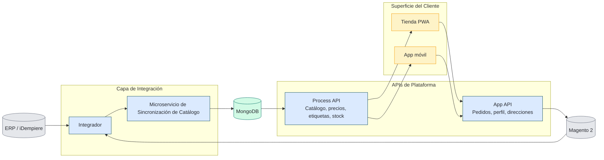

## TL;DR

- Un proyecto de e-commerce en Node.js + Angular en una cadena regional de supermercados había llegado a pre-lanzamiento sin una ruta de despliegue confiable.
- Me sumé como segundo ingeniero de un equipo de dos, terminé la plataforma y la entregué como **PWA + aplicaciones móviles a una base de clientes de alto volumen**.
- En el camino construimos el **registro de imágenes Docker y el pipeline de CI/CD** que hicieron posible la entrega continua, para este proyecto y para los que vinieron después.

## Contexto

Una cadena regional de supermercados en Venezuela tenía una iniciativa de e-commerce en marcha cuando me sumé: había un backend en Node.js, un frontend en Angular y una base de clientes esperando. Lo que faltaba era el camino desde "código en un repositorio" hasta "una aplicación que los clientes realmente usan".

La forma del trabajo la reconoce cualquier ingeniero que se haya sumado a un greenfield en pre-lanzamiento:

- Un código que corría en desarrollo pero que todavía no tenía una ruta de build o despliegue repetible.
- Una pregunta abierta sobre la superficie de cliente: PWA, aplicaciones nativas o ambas.
- Necesidades de negocio adyacentes (segmentación de clientes, ingesta de la tasa de cambio) esperando a alguien con el ancho de banda para tomarlas.

El encargo era simple en una frase y difícil en la práctica: *termínalo y entrégalo.*

## Restricciones

| Restricción | Realidad |
|---|---|
| Tamaño del equipo | 2 ingenieros en total, incluyéndome, embebidos con el negocio |
| Calendario | Meses, no trimestres: la cadena ya había esperado demasiado |
| Stack heredado | Backend en Node.js, frontend en Angular, sin historia de despliegue |
| Superficie de cliente | Había que llegar a los clientes en el teléfono, rápido y sin el calvario de las tiendas de aplicaciones |
| Trabajo adyacente | La segmentación de clientes y la ingesta de la tasa de cambio también estaban sobre la mesa |

Lo no negociable: entregar algo que los clientes pudieran usar y después construir la plataforma debajo que hiciera fácil lo siguiente.

## Arquitectura de un vistazo

Basado en la arquitectura original de entrega (simplificada del diagrama interno), este es el flujo que entregamos:

## Decisiones

### Decisión 1 — Entregar una PWA primero, las aplicaciones nativas después

El camino más rápido a una pantalla de teléfono no era un binario de iOS o Android, sino una aplicación web progresiva que los clientes pudieran instalar desde un enlace.

| Opción | Compensación | Elegí |
|---|---|---|
| Construir aplicaciones nativas de iOS + Android desde el primer día | Meses de trabajo específico por plataforma; revisión de la tienda de aplicaciones en cada cambio | |
| Entregar una PWA a partir del código Angular existente, envolverla como aplicaciones móviles después | Superficie web disponible en días, no meses; un solo código que mantener | <DecisionCheck /> |

Las aplicaciones móviles vinieron después, sobre la base que la PWA ya había probado.

### Decisión 2 — Construir la ruta de despliegue antes de terminar la funcionalidad

Por tentador que fuera perseguir el backlog de funcionalidad, el cuello de botella no eran las funcionalidades: era que nada se podía desplegar de forma confiable.

| Opción | Compensación | Elegí |
|---|---|---|
| Desplegar a mano hasta el lanzamiento y automatizar después | Más rápido el primer día; cada despliegue posterior cuesta la misma hora | |
| Levantar primero un registro Docker privado y un pipeline de CI/CD ligero | Dos semanas de trabajo de plataforma antes de entregar cualquier funcionalidad; cada despliegue posterior salía gratis | <DecisionCheck /> |

El mismo principio que en otros trabajos de rescate: estabiliza el runtime antes de perseguir la hoja de ruta. El pipeline sobrevivió al proyecto: el equipo que vino después lo siguió usando para los servicios en Node.js y Angular que llegaron luego.

### Decisión 3 — Tratar la segmentación de clientes como una misión secundaria pequeña y útil

Marketing quería saber a qué clientes hablar y cuándo. Hice un **análisis RFM** (Recencia, Frecuencia, Monto) sobre los datos de pedidos que la nueva plataforma ya estaba recogiendo.

| Opción | Compensación | Elegí |
|---|---|---|
| Esperar a que exista un equipo de datos dedicado | Meses esperando un insight que el negocio necesitaba ya | |
| Correr RFM sobre los datos existentes y entregar los segmentos a marketing | Ligero, útil de inmediato, y demostró que los datos de la nueva plataforma valían algo | <DecisionCheck /> |

No era una "plataforma de datos". Era un análisis de un solo ingeniero que se pagó solo la primera semana en que marketing lo usó.

### Decisión 4 — Automatizar la ingesta de la tasa de cambio en vez de teclearla

Fijar precios en Venezuela depende de la tasa de cambio oficial, que alguien del equipo copiaba y pegaba a diario. La carga manual de la tasa era propensa a errores y estaba por debajo del nivel de cualquiera que la hiciera.

| Opción | Compensación | Elegí |
|---|---|---|
| Seguir haciéndolo a mano | Gratis hasta que deja de serlo: un solo error de tecleo mueve los precios de todo un catálogo | |
| Extraer la tasa oficial de forma programada e inyectarla en la plataforma | Un pequeño job de ingesta; elimina una tarea diaria y una clase de bugs de precios | <DecisionCheck /> |

Esta es la semilla del trabajo del scraper del BCV sobre el que después escribí públicamente. Las automatizaciones pequeñas como esta suelen pagarse rápido, sobre todo porque eliminan un modo de fallo humano recurrente y no tanto porque ahorren tiempo directamente.

## Resultado

Al final del trabajo:

- La plataforma se entregó como **PWA + aplicaciones móviles usadas por una base de clientes de alto volumen**.
- La empresa quedó con un **registro Docker privado y un pipeline de CI/CD funcionando** para servicios en Node.js y Angular: la base de todo lo que vino después.
- Marketing tenía **segmentos de clientes basados en RFM** sobre los que podía actuar, sacados de los propios datos de la plataforma.
- Los precios corrían sobre un **feed automático de la tasa de cambio** en vez de un copiar y pegar diario.

<!-- > ⚠️ **Author note (placeholder, please confirm):** if you have any of these handy, drop them in to replace this callout — *time-from-takeover-to-launch*, *number of releases per week after CI/CD landed*, *uptime numbers*, or *order volume in the first month*. Even rough numbers from memory beat adjectives. -->

Mirándolo en retrospectiva, la secuencia importó más que el número de personas: tener la ruta de despliegue en su sitio antes de perseguir el backlog de funcionalidad es lo que hizo que el resto fuera entregable por un equipo pequeño.

## Qué haría distinto hoy

El mismo encargo hoy, el mismo tamaño de equipo, las mismas restricciones. Los instintos no cambiarían; los objetivos sí.

- **Frontend:** entregar la PWA igual, pero alojarla en **Cloudflare Pages** (o cualquier host estático gestionado con CDN en el edge). Rendimiento de Lighthouse como puerta en el CI, no como ocurrencia tardía.
- **Backend:** los mismos servicios en Node.js sobre un runtime de contenedores gestionado, sin registry privado que correr y parchear.
- **CI/CD:** un entorno de vista previa por cada PR conectado al CI. El pipeline que armé a mano en 2022 hoy son unas diez líneas de YAML, más o menos.
- **RFM y segmentación:** aterrizar los pedidos en un almacén de analítica gestionado vía un job programado, correr la consulta de RFM como una vista programada y mostrarle los segmentos a marketing en un tablero en vez de un CSV. El mismo análisis, sin un ingeniero en el circuito después de la primera semana.
- **Ingesta de la tasa de cambio:** job programado → cola gestionada → almacén de analítica + la caché del storefront. El scraper sigue corriendo; todo lo que lo rodea deja de ser un cron en una sola VM.
- **Aplicaciones móviles:** Capacitor o PWABuilder envolviendo la misma PWA, firmadas y publicadas con despliegues por etapas.

La forma del trabajo se mantiene —ruta de despliegue primero, superficie de cliente después, y las automatizaciones más pequeñas luego—. Una plataforma gestionada simplemente elimina buena parte de la plomería que antes era parte del trabajo.

---

*Si estás pasando por algo parecido y quieres un segundo par de ojos, con gusto lo conversamos — [escríbeme aquí](/es/contact).*
